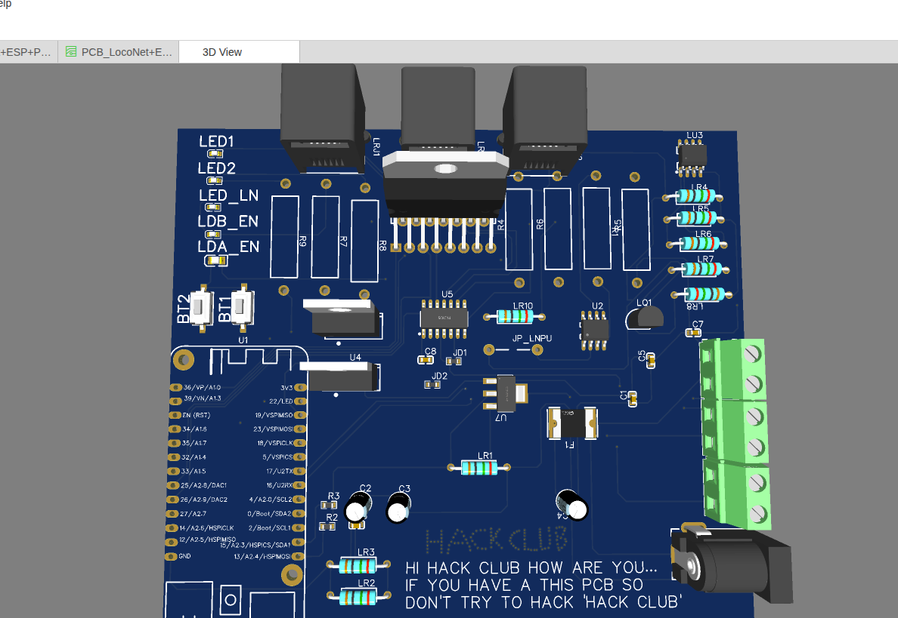
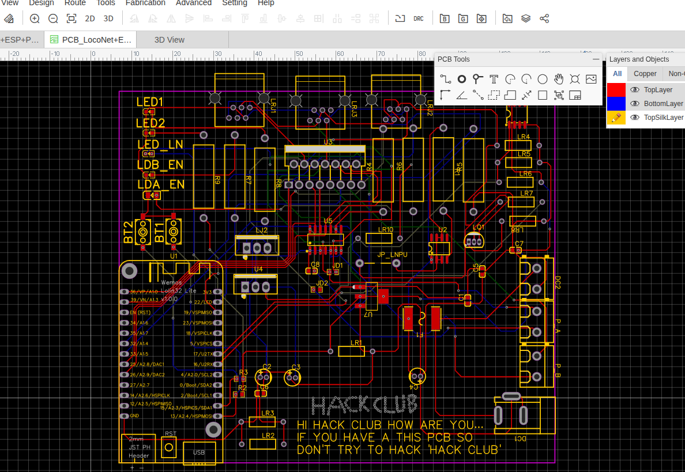
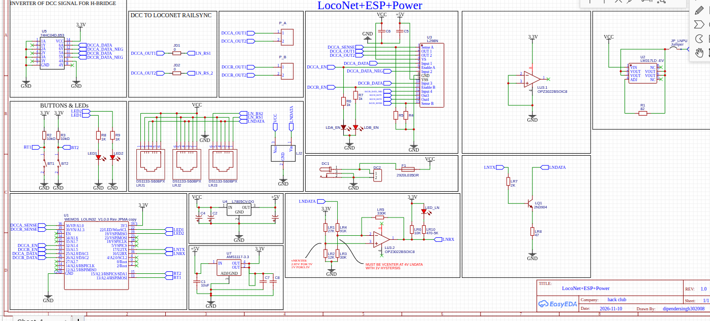

# Locotech

### ESP32-Based Railway Command Station

A WiFi PCB command station designed to control model railways using an ESP32.
The project combines DCC signal generation, LocoNet communication and WiFi connectivity into singel PCB.

## Demo Video

▶️ [Demo video](https://youtu.be/F_8z_gwi8js)

## lapse link 1

▶️ [lapse link](https://lapse.hackclub.com/timelapse/NA0Cyk8xJSxG)

## lapse link 2

▶️ [lapse link](https://lapse.hackclub.com/timelapse/N4DF30p9h8d1)

### 3D  image

### PCB Layout

### Circuit Schematic

## Repository Structure

| Folder/File | Description |
|---|---|
| BOM file/ | Bill of Materials |
| Gerber_LocoNet+ESP+Power.../ | PCB manufacturing files |
| PCB source file/ | EasyEDA PCB and schematic source |
| schematic file/ | Circuit schematic document |
| OBJ_PCB_LocoNet+ESP+Power.../ | 3D PCB model |
| image/ | Project images |
| README.md | Project documentation |

## PCB Design Files

The editable PCB design file :

`PCB source file/PCB_LocoNet+ESP+Power_2026-11-13.json`

The schematic source is available:

`PCB source file/SCH_LocoNet+ESP+Power_2026-11-13.json`

## Bill of Materials (BOM)

| Component | Designator | Quantity |
|---|---|---:|
| ESP32 Lolin32 Lite | U1 | 1 |
| L298N | U3 | 1 |
| 74HC04 | U5 | 1 |
| AMS1117-3.3V | U7 | 1 |
| LM317 | U2 | 1 |
| LM393 / LocoNet interface circuitry | LU3 | 1 |
| RJ11 Connectors | LRJ1, LRJ2, LRJ3 | 3 |
| L7805 | U4 | 1 |
| 2N3904 | LQ1 | 1 |

**Complete BOM:** `BOM file/BOM.csv`

## PCB Fabrication

PCB Manufacturer: JLCPCB / PCBWay

## How to Build Physically

### 1. Download the Project

Download the repository as a ZIP file or clone it from GitHub.

### 2. Open the PCB Design

Open [EasyEDA](https://easyeda.com/) and import gaber file.

### 3. Manufacture the PCB

Upload the Gerber files to a PCB manufacturer such as JLCPCB or PCBWay.

### 4. Assemble the PCB

Once the PCB is manufactured, solder the components according to the BOM and schematic.

## Project Status

**Current Deliverables:**
- PCB Design
- Circuit Schematic
- 3D PCB Model
- Gerber Manufacturing Files
- Bill of Materials (BOM)
- Firmware Repository

**Project Status:** Virtual PCB Design Project.

